<p align="center">
  <picture>
    <source media="(prefers-color-scheme: dark)" srcset="docs/assets/banner-dark.png">
    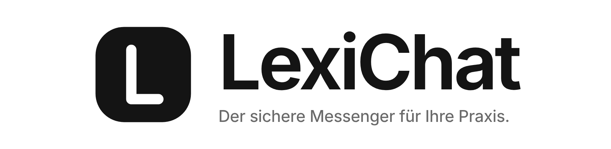
  </picture>
</p>

<p align="center">
  <b>Sicher schreiben. Nur das Team liest mit.</b><br>
  Interner, <b>Ende-zu-Ende-verschlüsselter</b> Messenger für Arztpraxen –<br>
  Windows-App für das Team, Web-App für die Verwaltung, Server in Deutschland oder der EU.
</p>

<p align="center">
  
  
  
  <br>
  
  
  
</p>

<p align="center">
  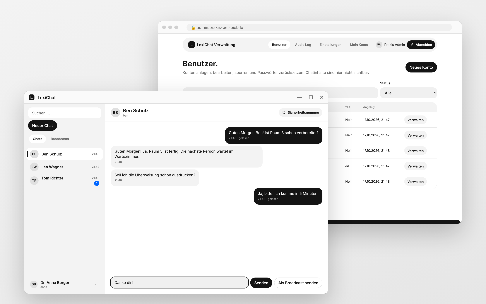
</p>

> **Status: MVP, alle 6 Entwicklungsphasen umgesetzt.** Vor dem Produktivbetrieb noch nötig: externer Penetrationstest, Prüfung der Datenschutz-Entwürfe durch DSB/Rechtsberatung, Code-Signing-Zertifikat + Update-Schlüssel, Test der Windows-App auf echten Praxis-PCs, Restore-Test auf dem echten Server. Details: [Security-Review](docs/04-security-review.md).

## Was LexiChat kann

| Funktion | Beschreibung |
|---|---|
| 🔒 **Ende-zu-Ende-verschlüsselt** | Nachrichten werden auf dem PC verschlüsselt und signiert (libsodium). Der Server – und damit auch Admins – sieht nur Zeichensalat. |
| 💬 **1:1-Chats in Echtzeit** | Bearbeiten, „Für alle löschen“, Zustell- und (freiwillige) Lesebestätigungen. |
| 📣 **Broadcasts** | Eine Nachricht an das ganze Team, z. B. „Teamsitzung um 13 Uhr“. Die Empfängerliste bestimmt der Server. |
| 🛡️ **Sicherheitsnummern** | Prüfen, dass niemand dazwischensitzt; Warnung bei Schlüsselwechsel. |
| 🔑 **Einmal anmelden** | Passwort nur beim ersten Start – danach öffnet sich die App auf dem PC direkt (Anmeldung DPAPI-geschützt im Windows-Konto, jederzeit widerrufbar). |
| 🔐 **App-Sperre** | Sichtschutz nach Inaktivität oder per Klick; Benachrichtigungen standardmäßig ohne Inhalt. |
| 👩‍💼 **Admin-Web-App** | Konten anlegen, sperren, Passwörter zurücksetzen, Audit-Log, Datenauskunft – aber **keine** Chatinhalte. |
| 🗑️ **Automatisches Löschen** | Nachrichten nach einstellbarer Frist (Standard 90 Tage), Datenschutz durch Voreinstellung. |
| 🇪🇺 **Ohne Drittanbieter** | Keine Cloud-Dienste, keine CDNs, keine Google Fonts, kein Tracking. Eigenes Hosting in DE/EU. |

## Windows-App

<table>
  <tr>
    <td width="50%">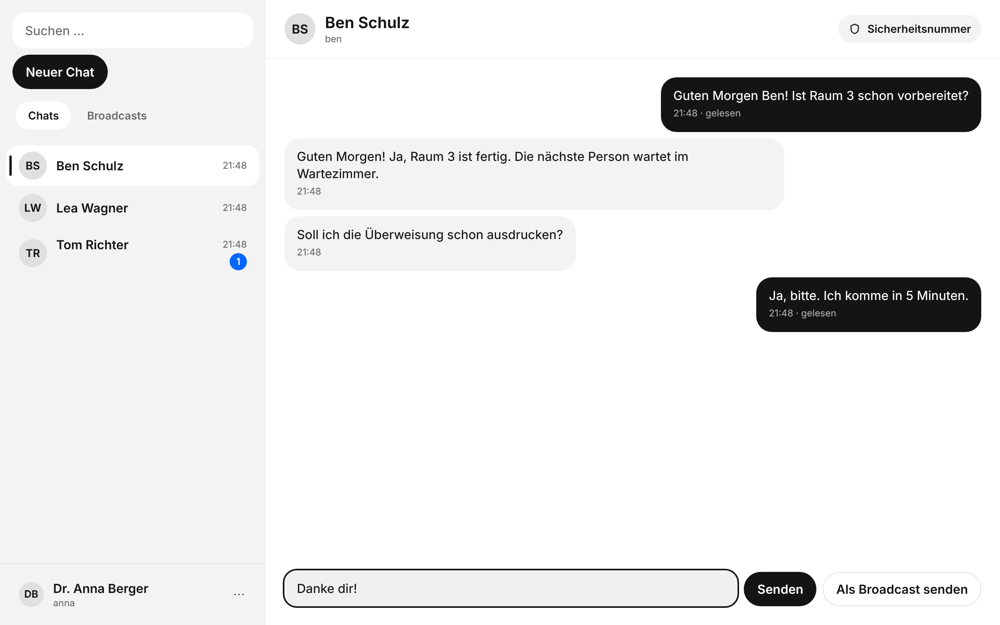<br><sub><b>Chat</b> – verschlüsselt, „gelesen“ erscheint nur, wenn die andere Person Lesebestätigungen eingeschaltet hat</sub></td>
    <td width="50%">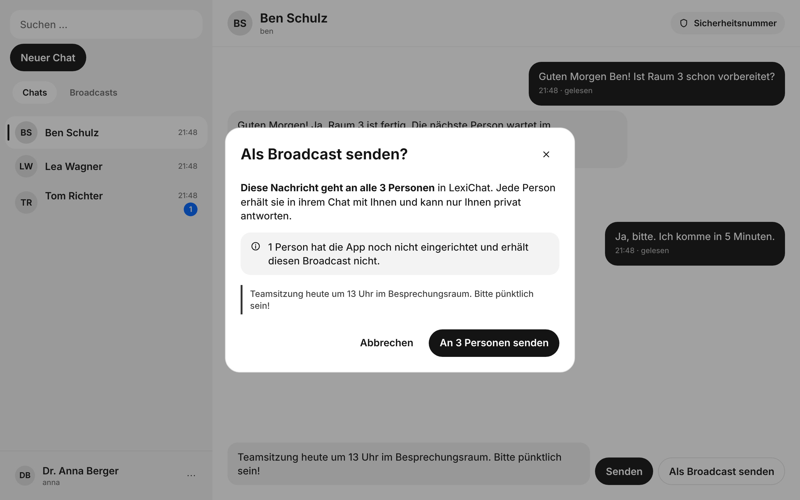<br><sub><b>Broadcast</b> – eine Nachricht an alle, mit Bestätigung</sub></td>
  </tr>
  <tr>
    <td>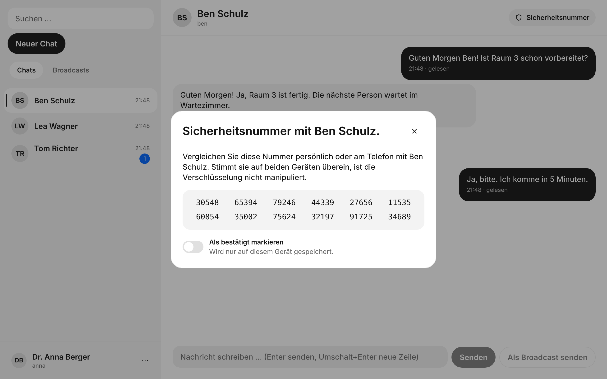<br><sub><b>Sicherheitsnummer</b> – persönlich vergleichen, Manipulation erkennen</sub></td>
    <td>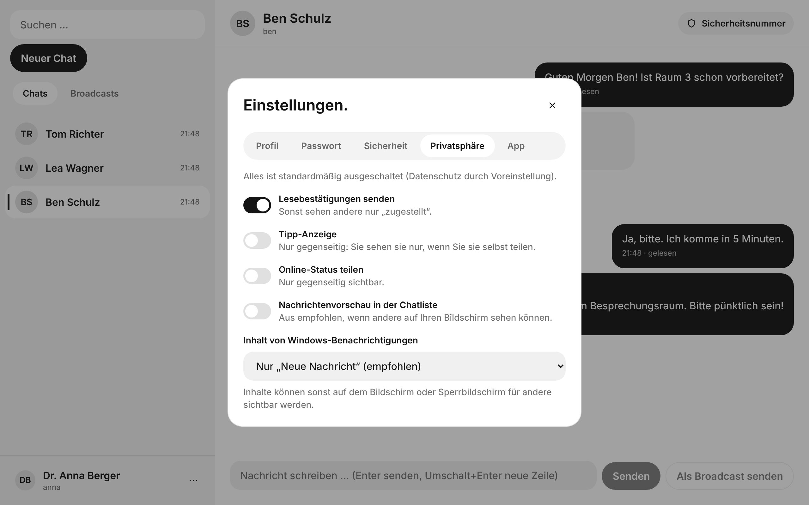<br><sub><b>Privatsphäre</b> – alles standardmäßig aus</sub></td>
  </tr>
  <tr>
    <td>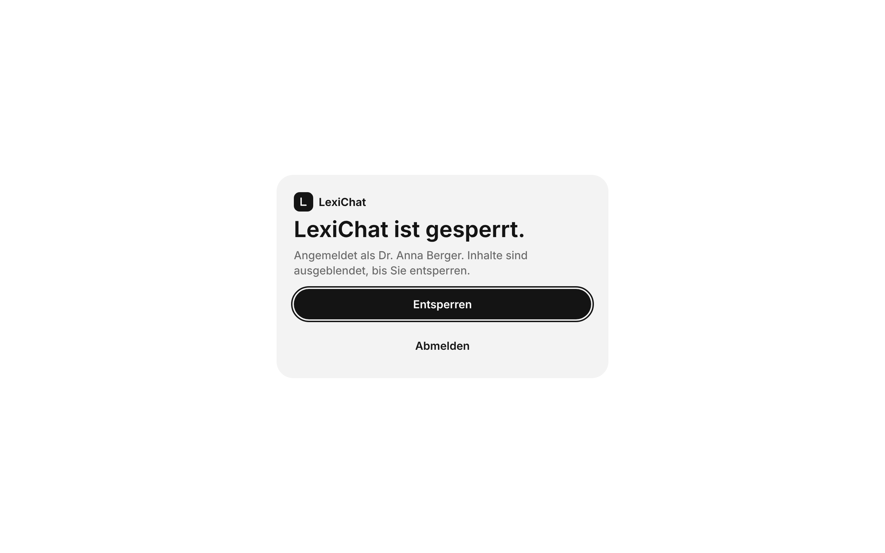<br><sub><b>App-Sperre</b> – Inhalte bleiben verborgen, bis Sie entsperren (ohne Passwort)</sub></td>
    <td>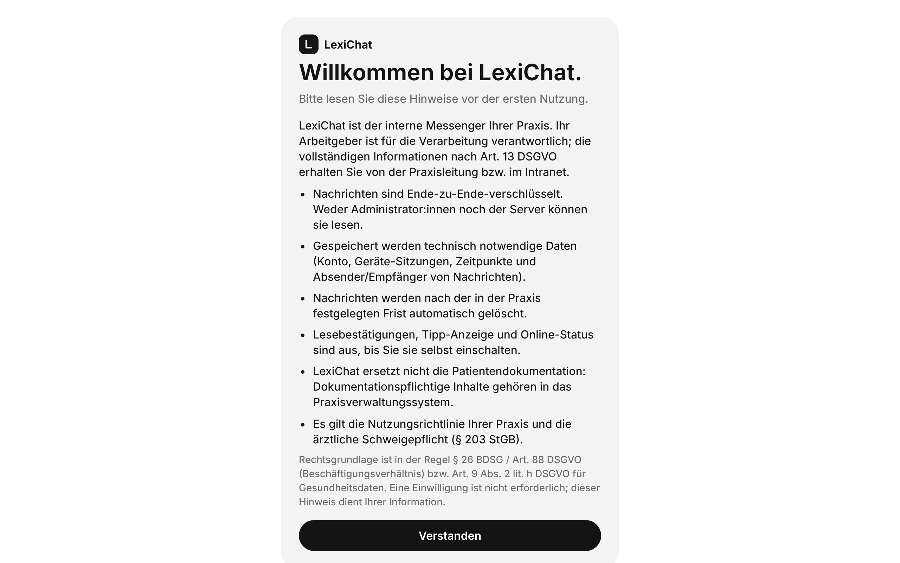<br><sub><b>Erster Start</b> – Datenschutz-Hinweis vor der Anmeldung</sub></td>
  </tr>
</table>

## Admin-Web-App

<table>
  <tr>
    <td width="50%">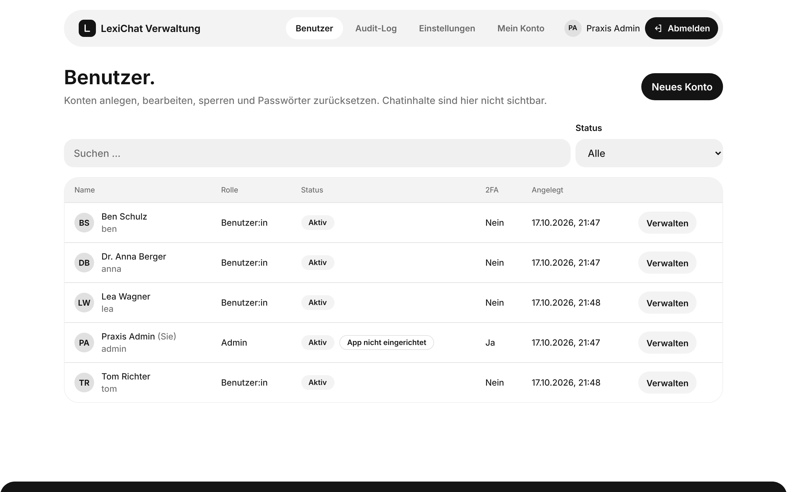<br><sub><b>Benutzer</b> – anlegen, sperren, Passwort zurücksetzen</sub></td>
    <td width="50%">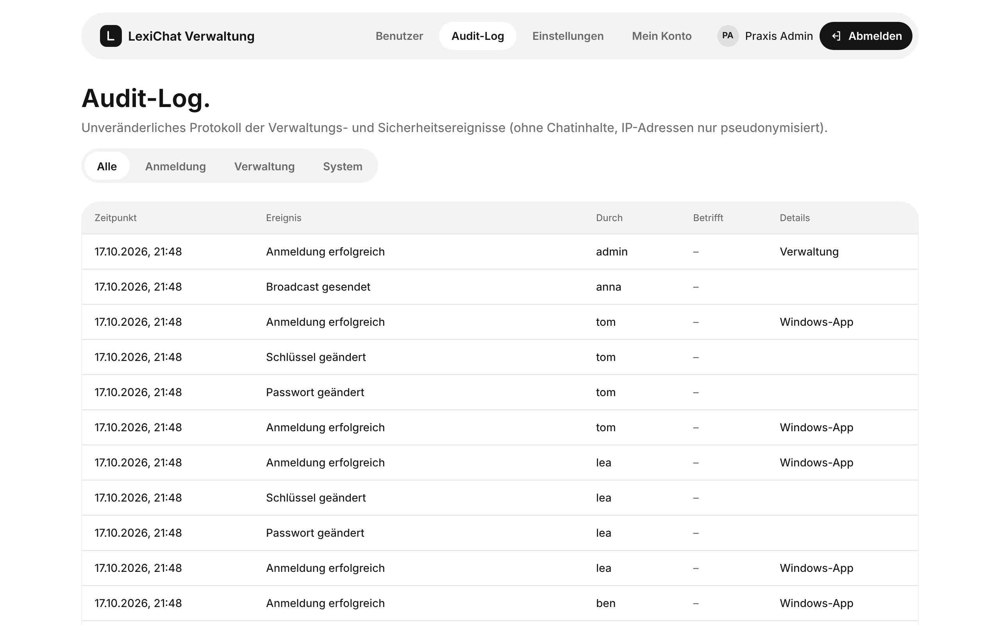<br><sub><b>Audit-Log</b> – unveränderlich, ohne Chatinhalte</sub></td>
  </tr>
  <tr>
    <td>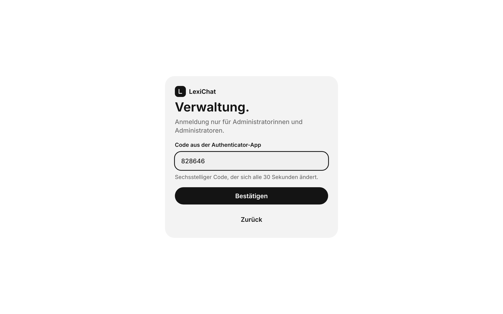<br><sub><b>Zwei-Faktor-Anmeldung</b> – Pflicht für Admins</sub></td>
    <td>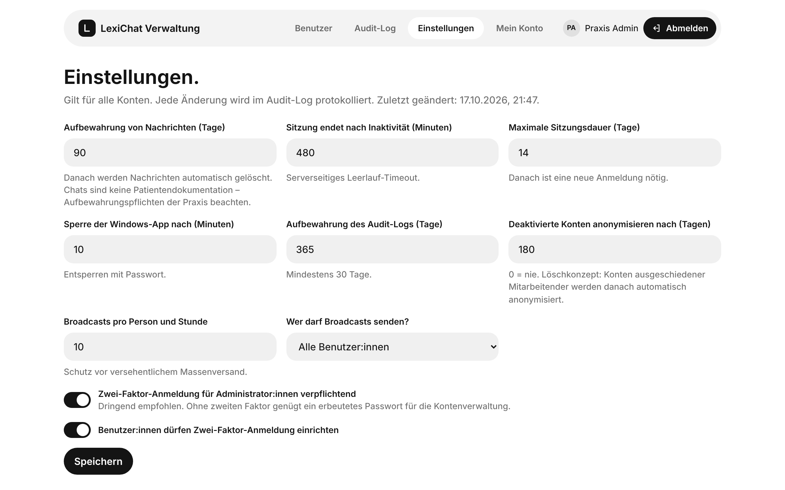<br><sub><b>Einstellungen</b> – Löschfristen, Broadcast-Recht, Sperrzeit</sub></td>
  </tr>
</table>

<sub>Alle Screenshots zeigen erfundene Demo-Personen und -Texte. Sie werden automatisch aus den echten Apps erzeugt: <code>pnpm --filter @lexichat/desktop screenshots</code>.</sub>

## So funktioniert es

```
 Windows-App (Team)            Admin-Web-App (Verwaltung)
 verschlüsselt + signiert       nur Benutzerverwaltung
          │                              │
          └──────── HTTPS (TLS 1.3) ─────┘
                         │
                 Caddy (Webserver)
                         │
          LexiChat-Server (PocketBase, Go)
          speichert nur verschlüsselte Daten
```

1. Annas App **verschlüsselt** die Nachricht für Ben und **signiert** sie.
2. Der Server speichert nur den verschlüsselten Text und leitet ihn sofort weiter.
3. Bens App **entschlüsselt** und prüft die Signatur.

Mehr dazu: [Architektur](docs/00-architektur.md) · [Bedrohungsmodell](docs/01-bedrohungsmodell.md)

## Komponenten

| Komponente | Technik | Ort |
|---|---|---|
| Server | PocketBase v0.40.5 als Go-Bibliothek + LexiChat-Hooks | `apps/server` |
| Admin-Web-App | React + Vite | `apps/admin-web` |
| Windows-App | Tauri v2 + React (+ Rust für Windows-Funktionen) | `apps/desktop` |
| Krypto | libsodium (E2EE, KDF, Signaturen) | `packages/crypto` |
| Design-System | eigene Komponenten, Inter lokal eingebunden | `packages/ui` |
| Deployment | Docker Compose, Caddy (TLS 1.3, Rate-Limits) | `deploy` |

## Dokumentation

- [Architektur und Annahmen](docs/00-architektur.md)
- [Bedrohungsmodell (STRIDE)](docs/01-bedrohungsmodell.md)
- [Rechtekonzept / API-Rules](docs/02-rechtekonzept.md)
- [Design-System](docs/03-design-system.md) · [Design-Vorlage](design/DESIGN.md)
- [Security-Review](docs/04-security-review.md) · [ASVS-L2-Checkliste](docs/05-asvs-checkliste.md)
- [Betriebshandbuch](docs/betriebshandbuch.md) (Installation, Backup/Restore, Windows-Release)
- [Datenschutz-Paket (Entwürfe)](docs/datenschutz/README.md)

## Installation (Server)

**Windows mit Docker Desktop (am einfachsten):** Docker Desktop installieren und starten, dann `deploy\windows\LexiChat-Starten.bat` doppelklicken. Das Skript fragt nach dem Server-Namen (Enter = nur dieser PC), erzeugt die Konfiguration, baut und startet alles und legt das erste Admin-Konto an. Details: [LexiChat auf Windows mit Docker](docs/windows-docker.md).

**Linux-Server**, Kurzfassung – die vollständige Anleitung steht im [Betriebshandbuch](docs/betriebshandbuch.md):

```bash
cd deploy
cp .env.example .env && chmod 600 .env     # Domains + Secret eintragen
docker compose up -d --build
./scripts/create-first-admin.sh admin "Praxis Admin"
```

## Entwicklung

```bash
cd apps/server
go test ./...                      # inkl. API-Rule-Tests gegen echte PocketBase-Instanzen
LEXICHAT_SERVER_SECRET=$(openssl rand -base64 48) go run . serve --dev
```
Go 1.27.2 wird über `toolchain` in `go.mod` automatisch geladen (`GOTOOLCHAIN=auto`).

```bash
corepack enable && pnpm install
pnpm typecheck && pnpm test         # TS-Pakete (KDF-Testvektor, Passwort-Policy, API-Client, Kontraste)
pnpm --filter @lexichat/admin-web dev   # http://localhost:5173, API-Proxy auf 127.0.0.1:8090
pnpm e2e:admin                      # baut Server + Web-App, Playwright inkl. axe und Produktions-CSP
```

```bash
# Windows-App
pnpm --filter @lexichat/desktop dev         # UI im Browser (native Funktionen als In-Memory-Fallback)
pnpm --filter @lexichat/desktop e2e         # Playwright gegen echten Server: E2EE-Chat, Broadcast, Sperre, Wiederherstellung, axe
pnpm --filter @lexichat/desktop screenshots # README-Bilder neu erzeugen (Demo-Daten)
pnpm --filter @lexichat/desktop tauri dev   # native App (Windows mit WebView2 + Rust-Toolchain)
LEXICHAT_SERVER=https://chat.praxis.example LEXICHAT_UPDATER_PUBKEY=… pnpm --filter @lexichat/desktop build:windows
```

## Wichtiger Hinweis

LexiChat ist für die **interne** Kommunikation von Beschäftigten gedacht, nicht für die Kommunikation mit Patientinnen und Patienten (dafür gibt es z. B. den TI-Messenger der gematik). Die Software macht eine Praxis **nicht automatisch DSGVO-konform** – die Datenschutz-Dokumente sind Entwürfe und müssen von der/dem Datenschutzbeauftragten bzw. einer Rechtsberatung geprüft werden.
